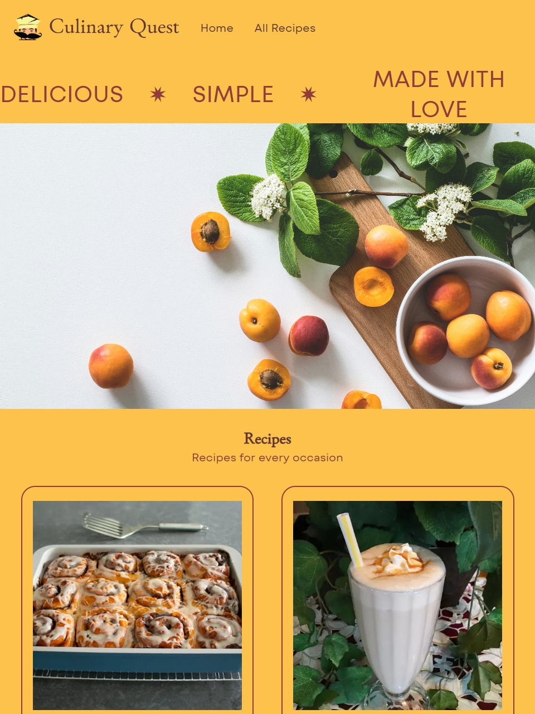

# Culinary Quest

Culinary Quest is a collection of simple, yet tasteful recipes. Welcome!

## Technologies

<ul>
  <li><code>React</code></li>
  <li><code>JavaScript</code></li>
  <li><code>React Router</code></li>
</ul>

## Preview

## Running the project

1. Clone the repository: <code>git clone https://github.com/Anna-Gladush/Culinary-Quest.git</code>

2. Install the packages using the command <code>npm install</code>

3. <code>npm run dev</code>
